# GordoStage

**Plataforma de logística de escenario.**

Stage plots y riders técnicos para bandas, productoras y equipos de montaje. Funciona como servidor local compartido desde un PC Windows, con acceso desde los navegadores de la misma red. También incluye un editor individual que se puede alojar como sitio estático.

## Descargar para Windows

Descarga **GordoStage-0.3.1-windows-x64.zip** desde [la Release v0.3.1](https://github.com/Lechuga-visual/stage-plot/releases/tag/v0.3.1), extrae todo y abre **Iniciar GordoStage.cmd**. Incluye la interfaz compilada y Node.js; no requiere herramientas de desarrollo. Los enlaces **Source code** son código fuente.

En una instalación nueva **no se pide clave**. La bienvenida permite abrir proyectos, importar/exportar JSON, configurar seguridad, registrar usuarios y elegir tema. El PC anfitrión administra los permisos desde su propio navegador. La consola muestra las direcciones LAN para los demás PCs y tablets. Mantén esa ventana abierta mientras trabajan; los datos se guardan en `data/` junto al lanzador. Es un ZIP portable con lanzador CMD; todavía no es un instalador ni un único `.exe`.

Consulta [distribución y actualización](docs/DISTRIBUCION.md) y [notas de versión](docs/RELEASE_NOTES.md).

## Muestras de la familia propia de iconos

Ya están disponibles [180 diseños SVG propios en la vista original](muestra-de-iconos/familia-gordostage-v1/) y [los mismos 180 en vista cenital](muestra-de-iconos/familia-gordostage-cenital-v1/), con el estilo de los 20 cenitales aprobados. Ambas colecciones incluyen variantes claras y oscuras: **720 SVG independientes**, láminas PNG, inventarios, catálogo HTML y ZIP descargable. Consulta [el índice de muestras](muestra-de-iconos/). La biblioteca activa de la aplicación conserva sus recursos actuales.

## Implementado

- **Proyectos compartidos:** crear y abrir varios proyectos; pestañas en la barra lateral, cierre de pestañas por dispositivo y nombre/descripción al pasar el ratón o enfocar. Cada puesto elige su proyecto sin cambiar la vista de los demás. Todos los proyectos guardados siguen disponibles en el servidor.
- **Bienvenida y temas:** accesos a proyectos, importación/exportación, configuración, permisos y usuarios. Tema oscuro Neón y tema claro GordoStage, guardados por navegador. El botón del encabezado también cambia el tema desde el editor.
- **Seguridad opcional:** activar/desactivar y cambiar la clave desde el PC anfitrión; habilitar/deshabilitar chat y exigir identificación con usuarios registrados. Perfiles con nombre, puesto, edición o lectura y PIN opcional. Las claves y PIN se guardan mediante hash con sal.
- **Identidad y chat:** identificación al abrir un proyecto, con puestos Escenario, FOH, Monitores, Producción, Backline, Iluminación, Vídeo, Booking y Otro. Nombre automático por puesto o alias. Chat flotante inferior derecho, minimizable, con aviso destacado de mensajes sin leer, sonido breve y mute por navegador; separado por proyecto y disponible también en la bienvenida.
- **Plano:** papelera para eliminar el equipo seleccionado con confirmación; las etiquetas permanecen sobre los iconos al superponerse. Instrumentos móviles y comentarios por equipo o por punto libre. Paleta compacta con iconos para seleccionar, dibujar, comentar, borrar un trazo completo o borrar partes con goma. Color, grosor, opacidad y deshacer/rehacer de dibujos.
- **Cableado visual:** rutas con esquinas y etiquetas para energía, audio, multipar, Ethernet y vídeo, con colores/estilos diferenciados y leyenda. Se conservan en JSON y PDF.
- **Biblioteca:** 173 símbolos WebP genéricos más 309 PNG de [TecRider](https://tecrider.com/stage-plot-icons) y 74 SVG X32/M32 de [mamarguerat/behringer-icons](https://github.com/mamarguerat/behringer-icons), **556 recursos en total**, con selector de estilo por proyecto y búsqueda en español o por nombre original y frecuentes. Subida de PNG, WebP o JPEG desde cualquier puesto editor; almacenamiento en el servidor y biblioteca compartida de personalizados.
- **Ficha técnica:** pulsar un equipo para indicar energía, entradas, micrófono/DI, señal mono/estéreo, phantom, soporte y notas. Las entradas generan canales vinculados; estéreo genera L/R. También se vinculan canales existentes. La opción de cantidad personalizada genera de 1 a 64 canales, etiquetables uno a uno.
- **Input list:** celdas editables, hasta 20 columnas personalizadas, nombres y orden configurables, altas/bajas y orden manual de hasta 500 canales. Asas de arrastre a ambos extremos, selección múltiple y destino por teclado para mover grupos conservando vínculos y patch. La edición de datos vinculados actualiza la ficha del equipo.
- **Lectura y acceso:** texto un 20% mayor por defecto, controles A−/A+ de 100% a 180% por dispositivo y dirección IP/puerto con botón Copiar en encabezado y bienvenida. Administración visiblemente deshabilitada fuera del anfitrión.
- **PDF configurable:** selección de secciones, equipos y canales; opciones de iconos, etiquetas, trazos, cableado, marcadores y cuadrícula. **Exportar con todo** omite la selección personalizada. La exportación no altera el proyecto.
- **Portabilidad:** JSON editable v5, con importación de versiones anteriores, e impresión a PDF del rider con plano, rutas, comentarios y resumen técnico. Los símbolos personalizados usados viajan incrustados en el JSON.

El [orden del input list](docs/INPUT_LIST.md) usa una convención de sonido en vivo como punto de partida: batería, percusión, bajo, guitarras, teclados, pistas/DJ, vientos/cuerdas, coros, voz principal y talkback. No impone una norma universal ni ordena automáticamente los canales nuevos. Consulta el [inventario completo de símbolos](docs/SIMBOLOS.md) y la [identidad visual](docs/IDENTIDAD.md).

## Capturas

Datos de ejemplo de la aplicación ejecutándose; se regeneran sin acceder a los proyectos del usuario.

### Bienvenida y proyectos

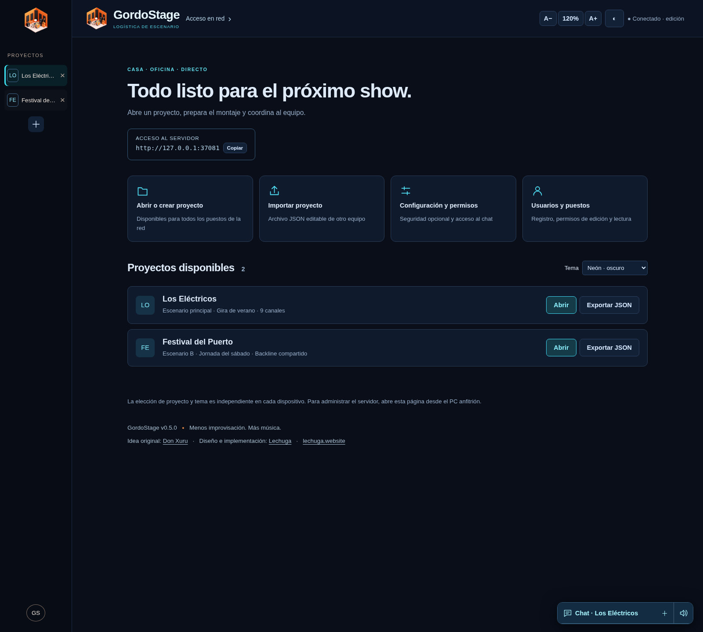

### Editor de escenario

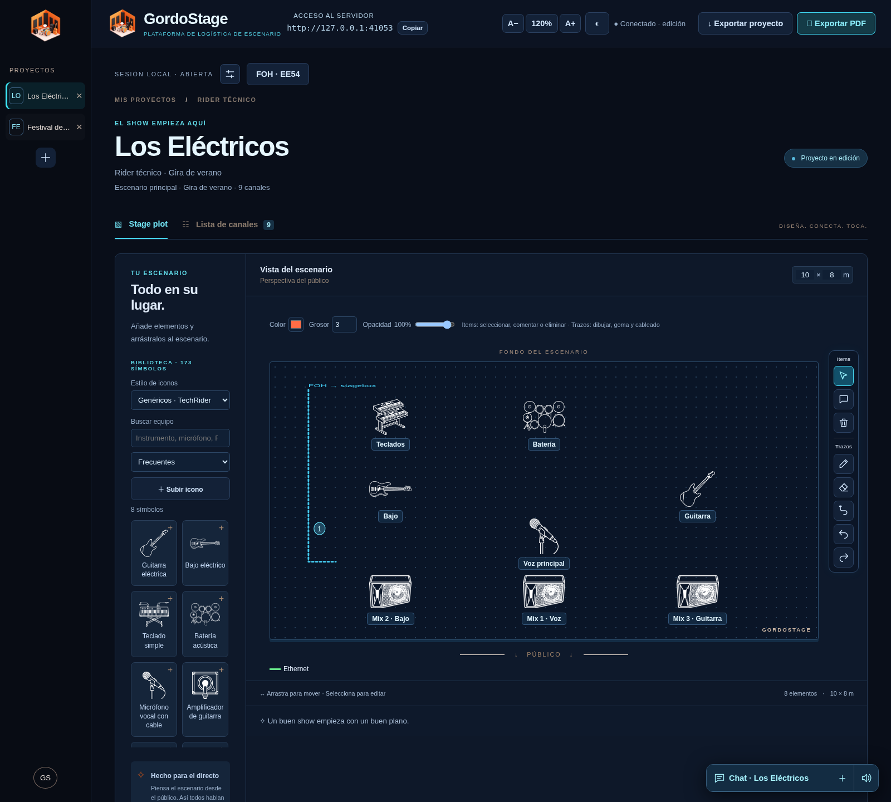

### Proyectos y descripción al pasar el ratón

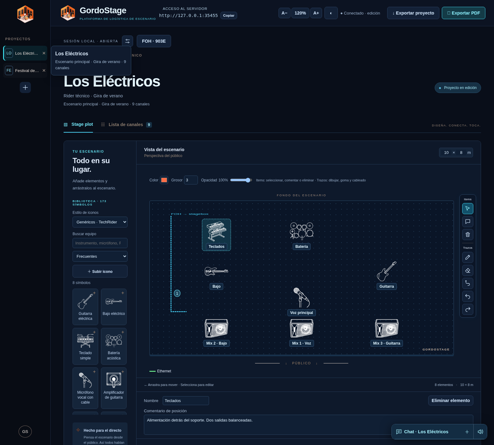

### Input list y datos técnicos

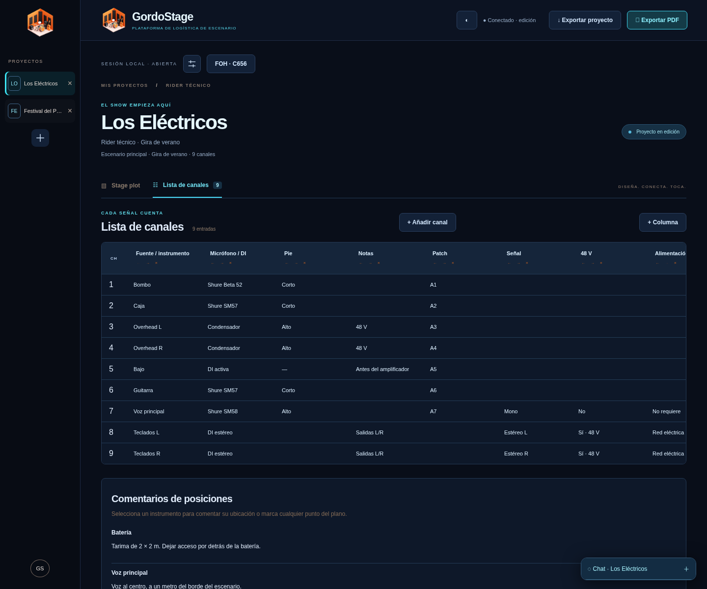

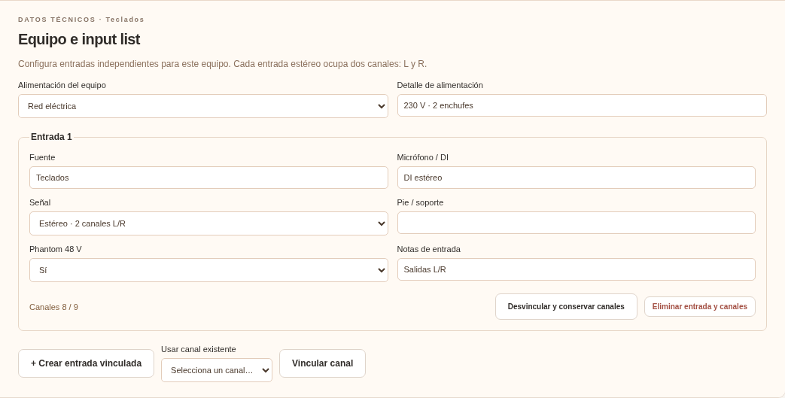

### Biblioteca y coordinación de montaje

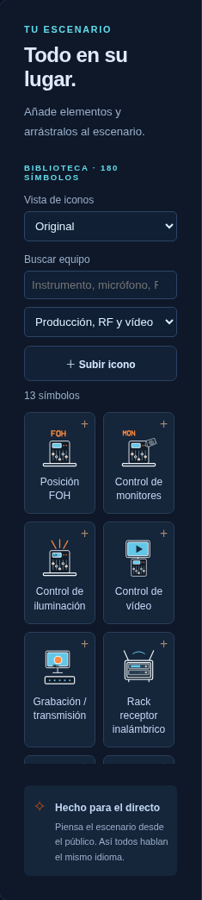

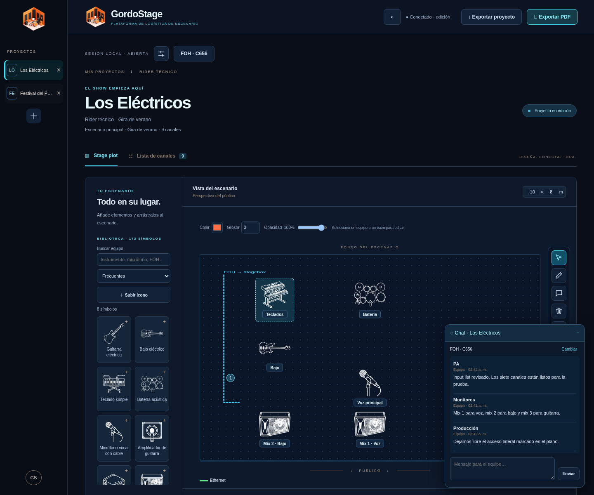

### Exportación y canales personalizados

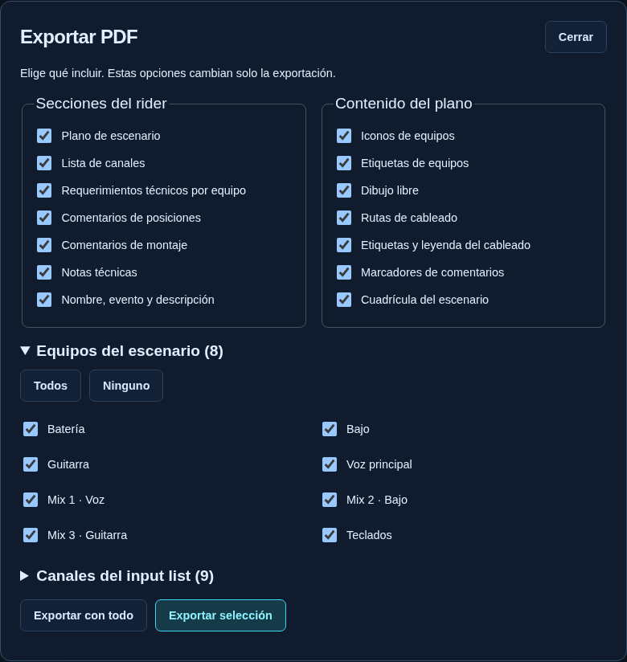

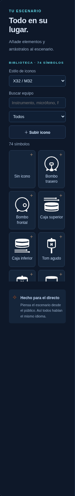

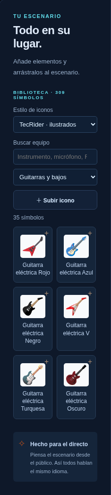

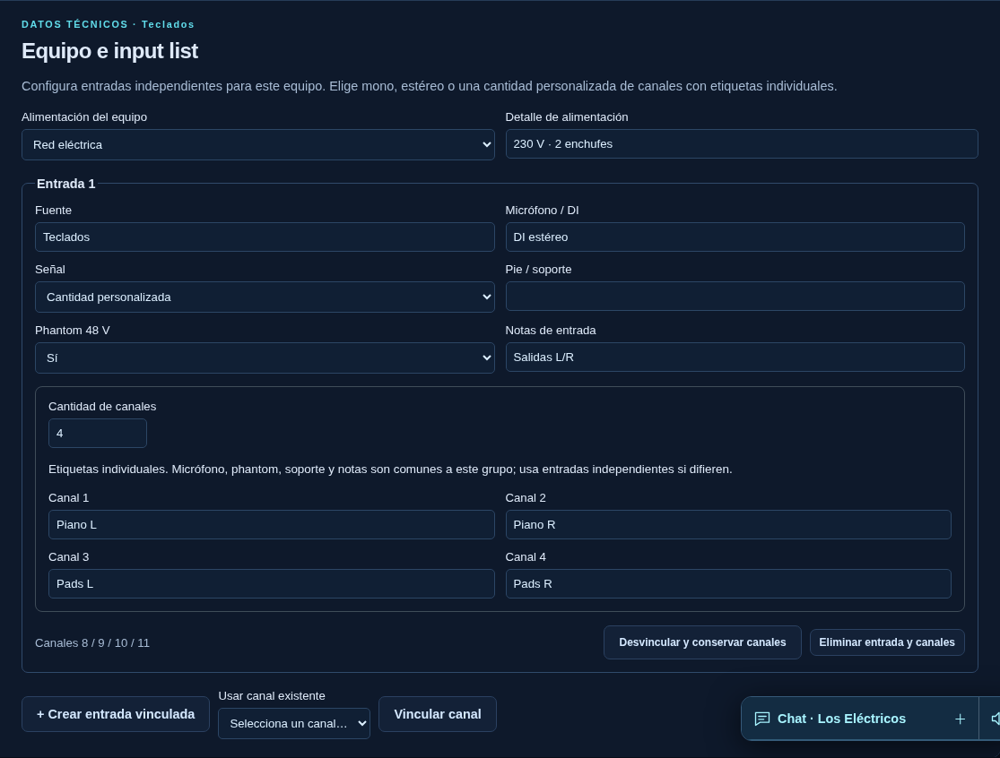

## Uso en red local

El anfitrión abre `http://127.0.0.1:3000`; los otros puestos usan una dirección LAN mostrada en la consola. Permite el puerto TCP 3000 en el firewall de la red privada si es necesario. No se instala nada en los dispositivos que acceden con navegador.

Desde **Configuración y permisos** el anfitrión decide si usa clave y puede cambiarla. En modo protegido, los otros dispositivos usan **Entrar a editar**. Un perfil de lectura permanece de lectura aunque conozca la clave. Los perfiles sin PIN sirven para identificarse; si necesitas controlar quién usa cada perfil, configura PIN y activa **Solo usuarios registrados**. Esta opción restringe la participación y edición; el rider sigue disponible para consulta en la red. No son cuentas de un servicio web.

Los datos se guardan en `data/stagecraft.sqlite`. Detén el servidor antes de copiar `data/` como respaldo completo: incluye proyectos, imágenes, chat, usuarios y configuración. El JSON transfiere un proyecto; no incluye chat, perfiles, PIN ni claves. En la bienvenida importar crea otro proyecto; en el editor importar sustituye el actual tras confirmación.

Cada guardado lleva una revisión. Si otro puesto guarda primero, se conserva la copia local y se indica conflicto; exporta esa copia antes de cargar la del servidor. WebSocket y consultas periódicas recuperan cambios. La app detecta conflictos por proyecto completo, sin combinar campos ni permitir edición colaborativa sin conexión.

## Ejecutar desde código fuente

Requiere Node.js 24 y npm:

```sh
npm ci
npm run build
npm start
```

`PORT` y `HOST` cambian puerto e interfaz. `STAGE_EDIT_CODE` permite configurar una clave inicial al crear una base nueva; después se conserva la configuración guardada y se administra desde la interfaz del anfitrión. Las versiones anteriores de la base y el chat se migran al proyecto inicial.

`npm run dev` inicia Vite en modo individual, sin API colaborativa. `dist/` se puede alojar como sitio estático barato: conserva el editor y almacenamiento del navegador, JSON y PDF. La bienvenida multiusuario, usuarios, chat y biblioteca compartida necesitan `npm start`. El servidor web con cuentas/organizaciones todavía está pendiente en [ROADMAP.md](ROADMAP.md).

## Comprobaciones y capturas

```sh
npm run build
npm test
npx playwright install chromium
npm run test:browser
npm run screenshots
npm run package:windows
npm run test:portable
```

En Linux con Chromium instalado puedes anteponer `CHROMIUM_PATH=/usr/bin/chromium` a las pruebas de navegador y capturas. Las pruebas usan bases temporales: verifican migraciones, permisos, persistencia, proyectos independientes, chat, dibujos/goma, cableado, imágenes, fichas, lista de canales, JSON, PDF y vista móvil. La publicación Windows exige además ejecutar el paquete con su runtime incluido en un runner Windows.

La goma divide trazos vectoriales. Deshacer/rehacer conserva hasta 50 pasos de dibujo en memoria por proyecto y se reinicia si llegan dibujos modificados desde otro puesto. Las rutas son anotaciones gráficas: no conectan puertos automáticamente ni calculan cargas. El usuario reportó funcionamiento correcto entre dos PCs de la misma red. La prueba de operación durante un montaje real queda para la siguiente etapa.

Enter envía el chat; Shift+Enter inserta una nueva línea. El sonido se habilita después de la primera interacción con la página por las reglas del navegador. El botón del altavoz permite silenciarlo sin quitar el aviso visual. Los estilos disponibles son Genéricos, X32/M32 y TecRider ilustrados. El modo de iconos se guarda en el proyecto; si un equipo genérico no tiene equivalencia X32/M32, conserva su símbolo. Los 74 SVG se distribuyen sin modificar, con licencia GPL-3.0 y procedencia en `public/symbols/behringer/`.
