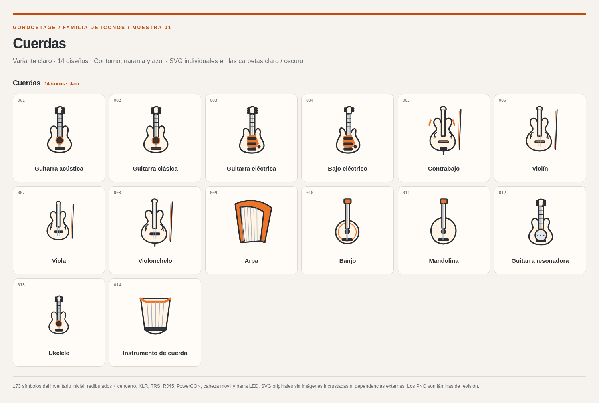
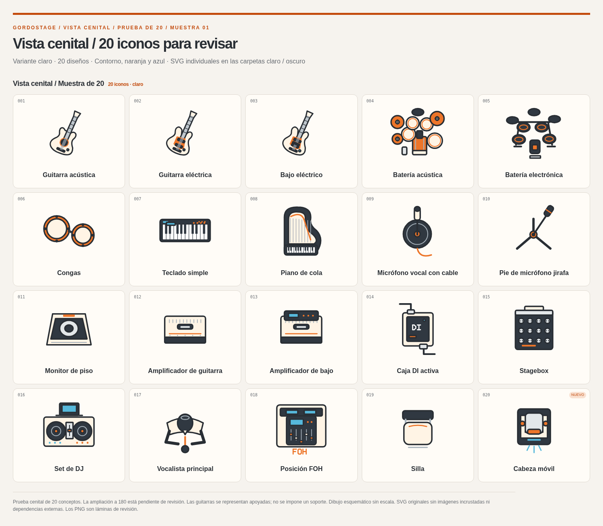
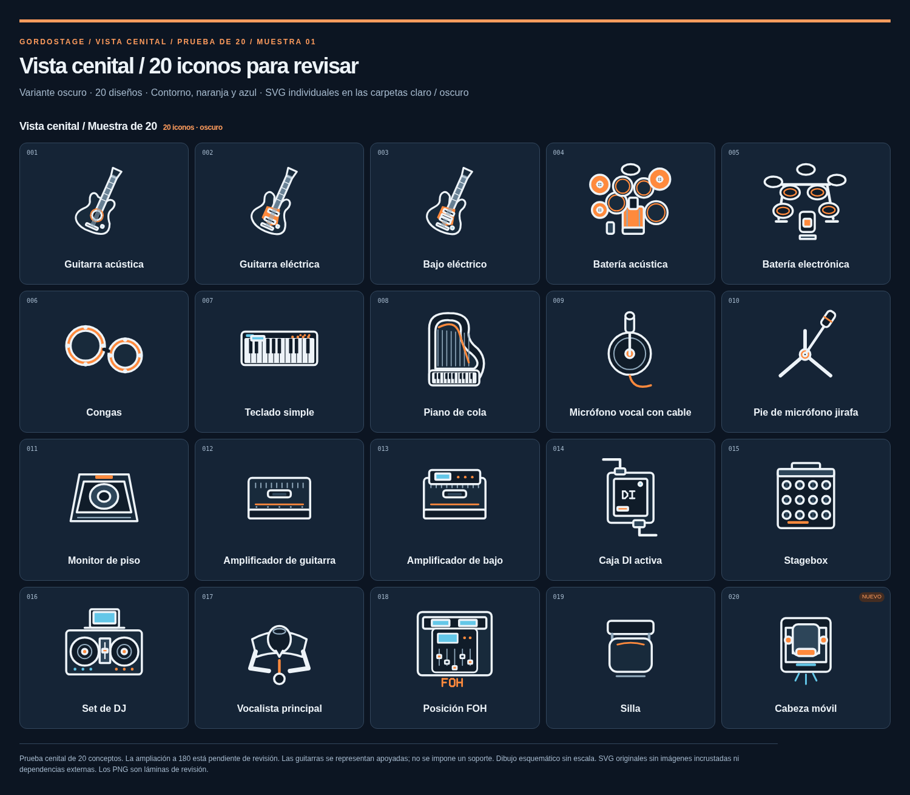
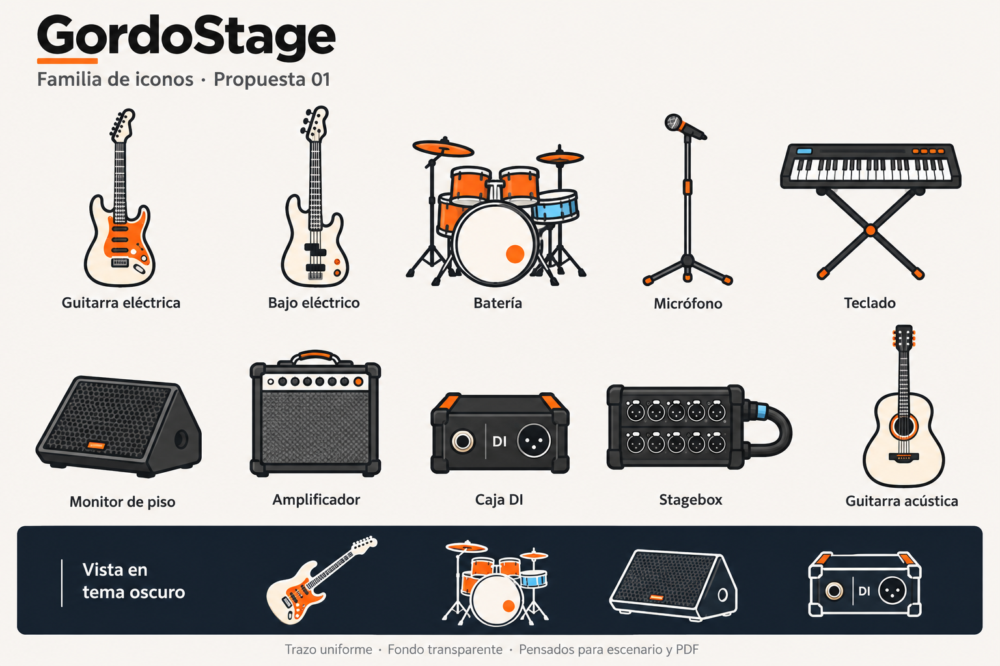

# Muestras de iconos de GordoStage

Familia propia en SVG, con contornos redondeados, superficies marfil/carbón, naranja y detalles azules. Cada icono está en un **archivo separado**, con fondo transparente y geometría editable. Los PNG sirven para revisar las colecciones en GitHub.

| Muestra | Diseños | SVG individuales | Claro | Oscuro | Descarga |
| --- | --- | --- | --- | --- | --- |
| [Familia completa — vista original](familia-gordostage-v1/) | 180 | 360 | [Carpeta](familia-gordostage-v1/claro/) | [Carpeta](familia-gordostage-v1/oscuro/) | [ZIP](gordostage-180-iconos-claro-oscuro.zip) |
| [Prueba de vista cenital](cenital-20/) | 20 | 40 | [Carpeta](cenital-20/claro/) | [Carpeta](cenital-20/oscuro/) | [ZIP](gordostage-muestra-20-cenitales.zip) |

**Total publicado: 400 SVG.** La prueba cenital usa 20 de los mismos conceptos de la familia completa; la ampliación cenital a 180 queda pendiente de revisar esta muestra. Ambas carpetas son propuestas para revisión y todavía no forman parte del selector de iconos de la aplicación.

## Familia completa: 180 diseños

El inventario inicial contiene **173 conceptos**. Se han redibujado y se añaden siete: **cencerro** (n.º 174), conector XLR, jack TRS, RJ45/Ethernet, PowerCON, cabeza móvil y barra LED. Se conservan los identificadores originales para facilitar una futura integración.

- [Inventario con enlaces a cada uno de los 360 SVG](familia-gordostage-v1/INVENTARIO.md).
- [Láminas por las 14 categorías, claras y oscuras](familia-gordostage-v1/laminas/).
- [Lámina completa sobre fondo claro](familia-gordostage-v1/laminas/catalogo-claro.png) · [Lámina completa sobre fondo oscuro](familia-gordostage-v1/laminas/catalogo-oscuro.png).



## Vista cenital: prueba de 20

La muestra compara instrumentos, baterías acústica/electrónica, congas, teclado, piano de cola, micrófono, pie con brazo, monitor, amplificadores, DI, stagebox, DJ, vocalista, FOH, silla y cabeza móvil. [Detalle de las convenciones y enlaces a cada archivo](cenital-20/README.md).





## Revisar y descargar

En GitHub puedes abrir las láminas o cualquier SVG individual. Para descargar un pack, abre su ZIP y pulsa **Download raw file**; también puedes usar los enlaces directos:

- [Descargar los 180 en claro y oscuro](https://github.com/Lechuga-visual/stage-plot/raw/refs/heads/main/muestra-de-iconos/gordostage-180-iconos-claro-oscuro.zip).
- [Descargar los 20 cenitales en claro y oscuro](https://github.com/Lechuga-visual/stage-plot/raw/refs/heads/main/muestra-de-iconos/gordostage-muestra-20-cenitales.zip).

Extrae el ZIP y abre `index.html` para buscar por nombre, filtrar por categoría, cambiar de fondo y comprobar tamaños de 32, 48, 64 y 116 px. El catálogo usa archivos locales y no necesita un servidor. Cada pack incluye `catalogo.json` con identificadores, nombres, categorías, variantes y rutas.

Los SVG comparten una vista de 100 × 100 y mantienen la misma geometría entre claro y oscuro. Son dibujos vectoriales propios; no son contenedores de WebP o PNG. Las medidas del dibujo son esquemáticas, sin escala física.

## Regenerar las muestras

Desde la raíz del repositorio, con Python 3, Node.js y las dependencias de desarrollo instaladas:

```sh
python3 scripts/generate-icon-sample.py
node scripts/render-icon-sample.mjs
```

El primer comando genera los SVG y los catálogos. El segundo comprueba inventarios, geometría, variantes, límites del dibujo y lectura de imágenes; verifica los controles del catálogo y genera las láminas y los ZIP. Usa Chromium en `/usr/bin/chromium` o la ruta de `CHROMIUM_PATH`. En el navegador administrado del entorno, la navegación directa a `file://` está bloqueada; las comprobaciones funcionales del catálogo se ejecutan sobre HTTP local.

## Referencia visual anterior

La propuesta PNG de diez iconos se conserva como referencia de estilo. Los SVG simplifican su detalle para funcionar a tamaños pequeños.

<details>
<summary>Ver propuesta 01</summary>



</details>
