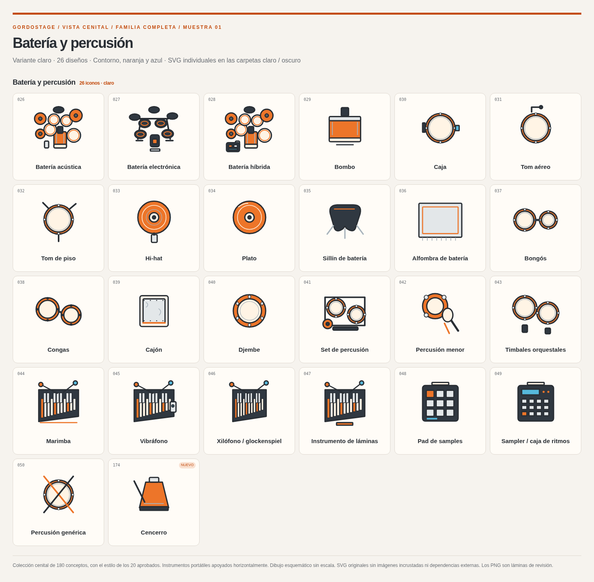
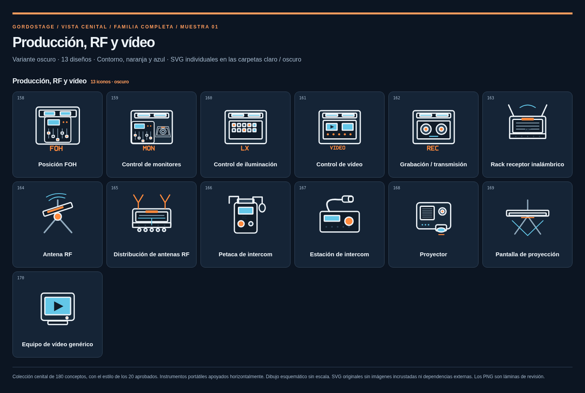

# GordoStage — 180 iconos cenitales

**180 conceptos, 360 SVG independientes, 14 categorías.** Colección completa en el estilo de la referencia de 20 aprobada. Cada diseño tiene una variante para fondos claros y otra para fondos oscuros, ambas con fondo transparente y exactamente la misma geometría.

- [SVG claros](claro/) · [SVG oscuros](oscuro/)
- [Inventario con enlaces a cada icono](INVENTARIO.md) · [Metadatos JSON](catalogo.json)
- [Láminas de las 14 categorías](laminas/)
- [Lámina completa clara](laminas/catalogo-claro.png) · [Lámina completa oscura](laminas/catalogo-oscuro.png)
- [Descargar ZIP cenital completo](../gordostage-180-cenitales-claro-oscuro.zip)
- [Colección en la vista original](../familia-gordostage-v1/) · [Referencia de 20 aprobada](../cenital-20/)

Extrae el ZIP y abre `index.html` para buscar, filtrar categorías, cambiar de tema y comparar tamaños de 32, 48, 64 y 116 px. El catálogo usa archivos locales y no requiere instalar la aplicación ni levantar un servidor.

## Vista superior

Los equipos y el mobiliario muestran la superficie superior y el contorno de su posición: asas y ventilación de amplificadores, rejillas y orientación de monitores, proyección de pies y brazos, teclas y controles, mesas, sillas y puestos de trabajo. La batería combina parches y platos circulares con el cuerpo del bombo visto desde arriba. En los músicos se ven cabeza, hombros, brazos y el instrumento o la superficie de trabajo; la orientación principal apunta hacia la parte inferior del dibujo.

Los instrumentos portátiles —guitarras, cuerdas frotadas, vientos y pequeños accesorios— se representan apoyados horizontalmente, con su cara útil hacia arriba, siguiendo la muestra aprobada. Esta convención no representa un instrumento vertical ni las dimensiones de su soporte. Las marcas de centro, notas, zonas y fuentes genéricas son símbolos funcionales planos.

Los dibujos son esquemáticos y **no están a escala física**. Los SVG tienen vista de 100 × 100, geometría editable y trazos redondeados; no contienen imágenes incrustadas, fuentes, scripts ni referencias remotas. Paleta: carbón/marfil, naranja y azul.





## Inventario y relación entre vistas

Se conservan los mismos identificadores, nombres, categorías y números de los 180 diseños de la vista original: 173 del inventario inicial más cencerro, XLR, TRS, RJ45, PowerCON, cabeza móvil y barra LED. Los 20 diseños cenitales aprobados están incluidos sin cambiar sus SVG. Cada archivo corresponde al mismo concepto en ambas colecciones.

La colección completa está publicada como recurso gráfico; la biblioteca activa de la aplicación mantiene su integración actual.

## Regenerar y comprobar

Desde la raíz del repositorio, con Python 3, Node.js, las dependencias de desarrollo y Chromium:

```sh
python3 scripts/generate-icon-sample.py
node scripts/render-icon-sample.mjs
```

Para regenerar solo las láminas y el ZIP cenital completo tras generar los SVG:

```sh
node scripts/render-icon-sample.mjs --pack=cenital
```

La comprobación revisa los 180 identificadores, la lectura de los 360 SVG, el margen de los dibujos, geometrías distintas entre conceptos, equivalencia entre claro/oscuro y conservación de los 20 aprobados. También ejercita los controles del catálogo y su vista móvil. La navegación directa a `file://` está bloqueada en el Chromium administrado del entorno; las pruebas funcionales se ejecutan por HTTP local. Usa `CHROMIUM_PATH` si Chromium no está en `/usr/bin/chromium`.
